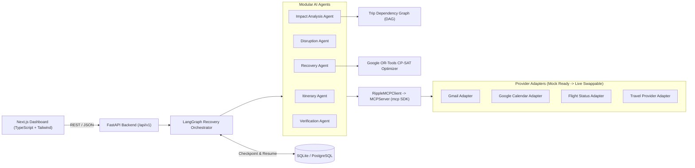

# RIPPLE — AI-Powered Travel Disruption Recovery System

> **When a flight gets cancelled or delayed, RIPPLE doesn't just suggest another flight.** It models the entire interconnected trip, traces downstream impact across connecting flights, airport transfers, hotels, and critical client meetings, optimizes recovery options with **Google OR-Tools**, orchestrates stateful multi-agent reasoning with **LangGraph**, connects via **MCP**, and enforces a strict **human-in-the-loop approval** gate before any booking is modified.

---

## 1. Problem Statement

Corporate and frequent travellers rarely travel on a single isolated ticket. One cancelled or delayed leg triggers a domino effect:
- Missed connecting flights on separate PNRs
- Expired airport transfer pickups
- Hotel no-show cancellations past late check-in cutoffs
- Missed high-stakes client meetings

Traditional airline rebooking portals only optimize a single ticket in isolation and ignore calendar commitments, hotel holds, transfers, and company travel policies.

---

## 2. Proposed Solution

**RIPPLE** treats travel as a unified **Trip Dependency Graph** rather than isolated bookings:
1. **Cross-Provider Ingestion (MCP):** Standardized Model Context Protocol (`MCPServer` + `RippleMCPClient`) tools query Gmail booking confirmations, Google Calendar commitments, live flight telemetry, and travel provider actions.
2. **Cascade Impact Tracing:** A Directed Acyclic Graph (`TripDependencyGraph`) calculates temporal slack, buffer violations, and downstream risk across all linked nodes.
3. **Constraint-Based Recovery Optimization (Google OR-Tools):** A CP-SAT solver evaluates candidate recovery routes against arrival deadlines, additional cost, stops, hotel cutoffs, and corporate travel policy caps.
4. **Stateful Multi-Agent Orchestration (LangGraph):** Modular agents progress through detection, verification, impact analysis, option generation, optimization, and pause at an explicit **Human Approval Checkpoint** (`interrupt_before=["human_approval"]`).
5. **Safe Execution & Verification:** Only after explicit human approval does RIPPLE execute coordinated modifications and verify every receipt.

---

## 3. Key Features

- **Unified Itinerary & Dependency Graph:** Models `FLIGHT`, `TRANSFER`, `HOTEL`, and `MEETING` nodes with hard/soft temporal edges and buffer constraints.
- **Stateful LangGraph Workflow:** `START → DETECT → VERIFY → ANALYSE IMPACT → GENERATE OPTIONS → OPTIMISE → HUMAN APPROVAL → EXECUTE → VERIFY → END`.
- **Google OR-Tools CP-SAT Engine:** Mathematically ranks feasible recovery options while clearly flagging deadline or policy violations.
- **MCP Tool Server & Client:** Built on the official `mcp` Python SDK (`MCPServer`), exposing 9 typed tools across Gmail, Calendar, Flight Status, and Travel Provider adapters.
- **Human-in-the-Loop Safety Gate:** Zero autonomous purchases or cancellations—every mutation requires explicit UI/API sign-off.
- **Modern SaaS Dashboard:** Next.js + TypeScript + Tailwind CSS dashboard featuring **Dashboard**, **Trip Details & Dependency Graph**, **Disruption Analysis**, and **Recovery Plans & Approval**.

---

## 4. System Architecture



See [docs/architecture.md](docs/architecture.md) and [docs/workflow.md](docs/workflow.md) for deep technical details.

---

## 5. Technology Stack

| Layer | Technologies |
| :--- | :--- |
| **Frontend** | Next.js 15, React 19, TypeScript, Tailwind CSS, Lucide Icons |
| **Backend API** | Python 3.11, FastAPI, Pydantic v2, Uvicorn |
| **Agent Orchestration** | LangGraph (`StateGraph`, `MemorySaver`, `interrupt_before`) |
| **Tool Protocol** | Official Model Context Protocol (`mcp` SDK `MCPServer`) |
| **Optimization** | Google OR-Tools (`cp_model` CP-SAT solver) |
| **Persistence** | SQLAlchemy 2.x (SQLite default for local dev; PostgreSQL-ready) |
| **Testing** | Pytest, FastAPI `TestClient`, `pytest-asyncio` |

---

## 6. Agent Workflow & Trip Dependency Graph

### Multi-Agent Pipeline
1. **`ItineraryAgent`**: Syncs Gmail booking confirmations and Google Calendar commitments via MCP.
2. **`DisruptionAgent`**: Detects cancellations/delays and verifies operational status via `flight_get_status`.
3. **`ImpactAnalysisAgent`**: Traverses `TripDependencyGraph` via BFS to mark downstream nodes as `BROKEN`, `NEEDS_UPDATE`, or `AT_RISK`.
4. **`RecoveryAgent`**: Fetches alternative routes (`flight_search_alternatives`), delegates ranking to `RecoveryOptimizer` (OR-Tools CP-SAT), and executes approved actions post-checkpoint.
5. **`VerificationAgent`**: Audits execution receipts and validates meeting/hotel preservation.

### Trip Dependency Graph
Nodes (`TripNode`) and directed edges (`TripEdge`) encode minimum buffer times (e.g., 60m Minimum Connection Time at BOM, 25m pickup buffer at DEL, 45m transit buffer before the 09:30 AM client meeting). When `flt_blr_bom` fails, the graph propagates impact deterministically across the entire chain.

---

## 7. MCP Integration Layer

The MCP server in `backend/app/integrations/mcp/server.py` registers 9 tools using `MCPServer("ripple-travel-tools")`:
- `gmail_fetch_confirmations`
- `calendar_list_commitments` & `calendar_send_advisory`
- `flight_get_status` & `flight_search_alternatives`
- `travel_book_flight`, `travel_cancel_flight`, `travel_reschedule_transfer`, `travel_notify_hotel`

All adapters implement abstract base classes (`GmailAdapter`, `GoogleCalendarAdapter`, `FlightStatusAdapter`, `TravelProviderAdapter`). When live OAuth/API keys are absent, RIPPLE uses deterministic mock adapters explicitly labelled `MOCK` / `MOCK_INVENTORY`.

---

## 8. Installation & Setup

### Prerequisites
- Python **3.11+**
- Node.js **20+** & npm

### 1. Environment Configuration
```bash
cp .env.example .env
```
By default, `.env.example` runs locally with `DATABASE_URL=sqlite:///./ripple.db` and `INTEGRATION_MODE=mock`.

### 2. Run the Backend (FastAPI + LangGraph + OR-Tools + MCP)
```bash
cd backend
python3.11 -m venv .venv
source .venv/bin/activate
pip install -r requirements.txt
uvicorn app.main:app --reload --port 8000
```
API docs will be available at `http://localhost:8000/docs`.

### 3. Run Backend Tests
```bash
cd backend
.venv/bin/pytest -v
```

### 4. Run the Frontend (Next.js Dashboard)
```bash
cd frontend
npm install
npm run dev
```
Open `http://localhost:3000` in your browser.

---

## 9. Demo Instructions (`BLR → BOM → DEL`)

1. Start both backend (`:8000`) and frontend (`:3000`).
2. On the **Dashboard**, inspect the seeded itinerary **FinEdge Q4 Architecture Review — Delhi** (`Aarav Mehta`: `6E-512 BLR→BOM` → `AI-806 BOM→DEL` → `BluSmart Transfer` → `The Oberoi` → `09:30 AM Client Meeting`).
3. Click **"Trigger BLR→BOM Cancellation"** in the left sidebar.
4. Inspect **Disruption Analysis** to see MCP verification, the 4 downstream affected commitments, and the LangGraph trace paused at `HUMAN_APPROVAL`.
5. Open **Recovery Plans** to compare the 4 OR-Tools ranked candidates (including why cheaper `6E-209` fails the 09:30 AM meeting deadline and why Business Class `AI-505` violates the ₹18,000 policy cap, making `AI-804` the optimal recommendation).
6. Click **"Approve & Execute Plan"** to resume the LangGraph workflow, execute simulated MCP bookings/cancellations/notifications, and inspect the **Verification** receipts.
7. Click **"Reset Baseline Trip"** at any time to replay the demo.

---

## 10. Current Implementation Status

| Capability | Status | Notes |
| :--- | :--- | :--- |
| FastAPI + SQLAlchemy (SQLite / Postgres-ready) | **Implemented** | Auto-seeds demo trips on startup |
| Trip Dependency Graph (`TripDependencyGraph`) | **Implemented** | BFS cascade tracing & buffer checks |
| Google OR-Tools CP-SAT Recovery Optimizer | **Implemented** | Real CP-SAT constraint solving & ranking |
| LangGraph Stateful Workflow + Human Checkpoint | **Implemented** | Uses `StateGraph`, `MemorySaver`, `interrupt_before` |
| MCP Server & Client (`mcp` SDK) | **Implemented** | 9 tools registered via `MCPServer` |
| Next.js 4-Screen SaaS Dashboard | **Implemented** | Live API integration across all views |
| Gmail, Calendar, Flight Telemetry, Airline Booking | **Simulated (Mock)** | Clean interfaces ready for OAuth/GDS keys |
| Live LLM Extraction from Unstructured Emails | **Planned** | Hooked via `.env` config; deterministic mocks active |

---

## 11. Future Scope

- Live Gmail & Google Calendar OAuth 2.0 connectors with LLM-based PNR/email parsing
- Live GDS / NDC airline inventory & FlightAware webhook ingestion
- Slack / WhatsApp / Email push notifications for traveller approval on mobile
- Multi-traveller group disruption optimization and automated expense reconciliation
