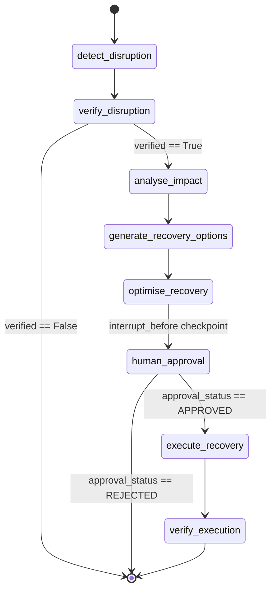

# RIPPLE LangGraph Recovery Workflow

## State Machine Overview

## Stage-by-Stage Execution

1. **`detect_disruption`**: `ItineraryAgent` syncs email confirmations and calendar commitments via MCP; `DisruptionAgent` captures the disruption event.
2. **`verify_disruption`**: `DisruptionAgent` verifies operational status via `flight_get_status`. Conditional edge exits cleanly on false alarms.
3. **`analyse_impact`**: `ImpactAnalysisAgent` constructs `TripDependencyGraph` and traces downstream failures (`BROKEN`, `NEEDS_UPDATE`, `AT_RISK`) plus dependency paths.
4. **`generate_recovery_options`**: `RecoveryAgent` queries `flight_search_alternatives` via MCP (returns candidates tagged `MOCK_INVENTORY`).
5. **`optimise_recovery`**: `RecoveryOptimizer` formulates a binary CP-SAT optimization problem in Google OR-Tools and ranks all options.
6. **`human_approval` (Checkpoint)**: Compiled with `interrupt_before=["human_approval"]` using LangGraph's `MemorySaver` (backed by SQL persistence in `recovery_workflow_runs`). Execution halts until `POST /api/v1/workflows/{run_id}/approve` is called.
7. **`execute_recovery`**: Dispatches approved `BOOK_FLIGHT`, `CANCEL_FLIGHT`, `UPDATE_TRANSFER`, `NOTIFY_HOTEL`, and `NOTIFY_MEETING` calls through MCP Travel Provider tools.
8. **`verify_execution`**: `VerificationAgent` validates all confirmation codes and updates trip status to `RECOVERED`.
